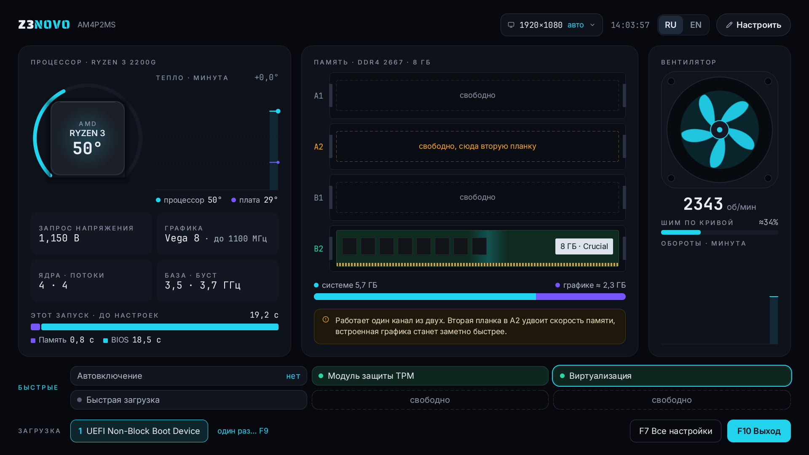

# Z3NOVO — прошивка BIOS для Lenovo ThinkCentre M715s

[Русский](#z3novo--прошивка-bios-для-lenovo-thinkcentre-m715s) · [English](#z3novo--bios-firmware-for-lenovo-thinkcentre-m715s)

> **Статус: публичный тест.** Первая тестовая версия — **T1**: [скачать](https://github.com/airtwist223/z3novo/releases/tag/T1), [что в ней](CHANGELOG.md).
> Это неофициальная прошивка: не от Lenovo и не от AMD. Ставите на свой страх и риск.
> Перед установкой обязательно сохраните копию своей микросхемы BIOS (см. [docs/FLASHING.md](docs/FLASHING.md)).
> **Проверено только на плате AM4P2MS ревизии 1.1.** На других ревизиях работа не проверялась и не гарантируется.

  

Главный экран нового меню: процессор и его температура, память по слотам, вентилятор, быстрые настройки.

## Отказ от ответственности

- Прошивка распространяется **«как есть», без каких-либо гарантий**. Вы устанавливаете её сами, по своему решению и на
  свой риск.
- Автор **не несёт ответственности** за любые последствия установки и использования: неработающий или повреждённый
  компьютер, вышедшие из строя детали, потерю данных, потерю гарантии, расходы на ремонт и любой другой ущерб.
- Каждая версия перед выпуском проверяется на **собственном компьютере автора** (Lenovo ThinkCentre M715s, плата AM4P2MS
  ревизии 1.1, Ryzen 3 2200G, 2 × 8 ГБ DDR4-2666). Что проверено — отмечено в таблице «Что работает, а что нет» и в [истории версий](CHANGELOG.md).
  Всё, что не отмечено как проверенное, **не проверялось** и может не работать.
- Это неофициальная прошивка. Lenovo, AMD, AMI, Biostar и Realtek к ней отношения не имеют и её не поддерживают.
  Установка неофициального BIOS может лишить вас гарантии производителя.
- Перед установкой сохраните копию своего BIOS: это единственный способ вернуть всё как было.

Устанавливая прошивку, вы соглашаетесь с этими условиями.

## Что это

Z3NOVO — прошивка для Lenovo ThinkCentre M715s (корпус SFF, плата AM4P2MS, чипсет AMD B350).
**Ревизия платы — 1.1:** только на ней прошивка проверена. Плата AM4P2MS выпускалась и в других ревизиях (например, 1.5),
и разводка у них может отличаться, поэтому на них прошивка может работать не полностью или не запуститься. Ревизия
напечатана на самой плате рядом с её названием (надпись вида «AM4P2MS Ver 1.1»); посмотрите её до установки.
Основа — AMI Aptio V с AGESA ComboAM4v2PI 1.2.0.F (от платы Biostar на том же чипсете), в которую перенесены таблицы
именно этой платы Lenovo: линии PCIe, выводы, питание, вентилятор, Super I/O. Вместо старого текстового меню —
своё графическое приложение настроек с мышью, на русском и английском.

## Что умеет

- **Процессоры:** Ryzen 1000–5000 для AM4 по возможностям AGESA. На этой плате проверен только Ryzen 3 2200G.
  Процессоры без встроенной графики (например, Ryzen 7 2700, Ryzen 5 5600) работают только с видеокартой.
- **Приложение настроек (Del):** мышь и клавиатура, RU/EN, поиск по настройкам, простой режим и все настройки,
  страница состояния (температура процессора, вентилятор), меню загрузки (F9), разрешение экрана по монитору,
  экранная клавиатура.
- **Вентилятор:** плавную кривую ведёт прошивка; режимы «Тихо», «Авто», «Макс» и свой редактор кривой.
- **Родная микросхема платы.** Прошивка работает с той микросхемой питания, вентиляторов и датчиков, которая стоит
  именно на M715s, — ITE IT8738. Её настройку мы взяли из родной прошивки Lenovo (те же значения, что выставляет
  BIOS Lenovo) и встроили вместо настройки чужой микросхемы платы-донора, а поверх написали свои драйверы. Поэтому
  вентилятор процессора работает на своём разъёме и регулируется самой прошивкой, а кнопка питания, включение после
  пропадания света и пробуждение работают как задумано. Прошивки, перенесённые
  с других плат, рассчитаны на другую микросхему: например, у AFOX X470D4-MA-V2 стоит IT8613, и на M715s с ней
  вентилятор процессора приходится переключать в разъём SYS_FAN, а обороты регулировать программой в Windows.
- **Стабильный старт:** исправлены зависания при включении и перезагрузке, найденные на этой плате с Ryzen 3 2200G
  (в проверке 100 перезагрузок из 100).
- **Включение после пропадания питания** (настройка «Restore on AC Power Loss»).
- **Загрузка по сети UEFI (PXE).**
- **DASH** — удалённое управление по сети через встроенную сетевую карту. По умолчанию выключено. Настройки сети
  DASH (адрес, маска, шлюз, имя) меняются прямо в приложении.
- **Обновление прошивки с флешки** прямо из меню, без программатора ([как](docs/FLASHING.md#обновление)), и **«Отчёт для
  диагностики»** по клавише F11 — файл на флешке, который прикладывают к сообщению о проблеме ([подробнее](docs/DIAGNOSTICS.md)).

## Что мы написали сами

Z3NOVO — это не «слегка переделанный Biostar». От прошивки-донора взята только основа: код AMD и AMI, который запускает
процессор, память и чипсет. Всё, что вы видите, и всё, что делает прошивку стабильной именно на M715s, сделано заново:

- около **34 000 строк** своего кода на C в меню Z3NOVO и около **4 600 строк** в своих драйверах прошивки (C и ассемблер);
- исправлено **больше 15 модулей** Biostar, AMD, AMI и Realtek;
- около **1 200 автоматических проверок** меню в эмуляторе перед каждой сборкой;
- **сотни перезагрузок** на настоящей плате, пока искали и чинили зависания.

| Что | Что делает | Что это дало |
|---|---|---|
| **Меню Z3NOVO** | графическое меню настроек внутри BIOS: мышь, RU/EN, поиск, простой режим, редактор кривой вентилятора, настройки сети DASH, отчёт F11, обновление с флешки | удобная настройка вместо старого текстового меню |
| **Z3Entry** (драйвер) | по клавишам Del и F9 открывает наше меню и наше меню загрузки | новое меню без лишних шагов |
| **Z3Chip** (драйвер) | работает с микросхемой датчиков и питания (Super I/O) с проверкой каждого обращения, выключает её собственный опрос температуры, включает компьютер после пропадания света по логике Lenovo, включает и выключает DASH | ушли зависания из-за этой микросхемы, работает автовключение |
| **Z3Fan** (драйвер) | дважды в секунду берёт температуру прямо из процессора и плавно ведёт вентилятор — и в BIOS, и в Windows, и в Linux | тихий вентилятор без рывков |
| **Ранние исправления запуска** | ограничение времени на обмен по шине LPC, проверенная начальная настройка Super I/O, страховочный таймер на опасных участках, паузы без лишних обращений к шине | исчезли зависания при включении и перезагрузке: 100 перезагрузок из 100 |
| **Журнал запусков** | при каждом включении записывает, до какого шага дошёл запуск и почему плата перезагрузилась | по нему нашли причины зависаний; на нём держится отчёт F11 |
| **Доработанные модули AMD, Biostar и Realtek** | драйвер сетевой карты Realtek (зависал при сохранении настроек DASH), видеовыходы (DisplayPort вместо HDMI), лишние записи в микросхему Super I/O в модулях Biostar | сохраняются настройки DASH, правильно работают разъёмы DisplayPort |
| **Адаптация под плату M715s** | из родной прошивки Lenovo перенесено устройство именно этой платы: какие разъёмы и слоты куда подключены, видеовыходы, питание процессоров, настройка Super I/O | прошивка знает, как разведена M715s, а не плата-донор |
| **Инструменты вне BIOS** | скрипты отчёта для Windows и Linux, расшифровщик отчётов, тест-флешка (готовится) | сведения о сбоях у тестеров собираются за минуту |

## Что работает, а что нет

Проверено на плате AM4P2MS ревизии 1.1 с Ryzen 3 2200G и двумя планками по 8 ГБ.

| | ✅ Работает | ⚠️ Не проверено | ❌ Не работает |
|---|---|---|---|
| **Процессор** | Ryzen 3 2200G | другие Ryzen 1000–5000 | A-серия (A6–A12), разгон |
| **Память** | 2 планки в двухканале, DDR4-2667 | 4 планки, профиль XMP | напряжение выше 1,2 В |
| **Монитор** | оба разъёма DisplayPort (кабель DP→HDMI) | кабель DP→DP, VGA | |
| **Видеокарта** | | в слоте PCIe x16; Resizable BAR — новый переключатель в меню (нужны видеокарта и процессор с его поддержкой) | |
| **USB** | USB 3.0, клавиатура, мышь | каждый разъём по отдельности | |
| **Диски** | SATA (SSD, HDD) | M.2 SSD | |
| **Сеть** | интернет 1 Гбит/с, включение по сети (Wake-on-LAN) | загрузка системы с сервера по сети (PXE) | |
| **DASH** (удалённое управление) | текстовая консоль по сети, настройка адреса DASH в новом меню, веб-страница DASH, удалённые включение, выключение и перезагрузка (в Linux — с параметром `module_blacklist=i2c_piix4`) | экран BIOS в консоли DASH | подключение ISO по сети |
| **Питание** | 100 перезагрузок без зависаний, сон, включение по таймеру и после отключения света | | |
| **Меню BIOS** | новое меню (Del), выбор загрузки (F9), отчёт для диагностики (F11), обновление прошивки с флешки | | |
| **Системы** | Linux | Windows | |
| **Звук** | | на плате и через DisplayPort | |
| **Прочее** | TPM 2.0, вентилятор процессора | COM-порт | |

## Ограничения железа

Коротко: **напряжение памяти на этой плате всегда 1,2 В** — его не меняет никакая прошивка; питание процессора на плате рассчитано на
процессоры до 65 Вт (кулер и блок питания можно поставить мощнее, а схему питания на плате — только лучше охлаждать). Подробно, с последствиями для XMP, разгона и памяти встроенной графики: [docs/LIMITS.md](docs/LIMITS.md).

## Документы

- [docs/FLASHING.md](docs/FLASHING.md) — установка, обновление, откат.
- [docs/LIMITS.md](docs/LIMITS.md) — что плата может и чего не может.
- [docs/DIAGNOSTICS.md](docs/DIAGNOSTICS.md) — как собрать отчёт о проблеме.
- Всё работает? Расскажите через форму **«Всё работает»** в разделе Issues — так собирается список проверенных сборок.
- Есть идея, что-то неудобно или криво в меню? Форма **«Идея или неудобство в меню»** в разделе Issues.
- [docs/KNOWN_ISSUES.md](docs/KNOWN_ISSUES.md) — известные проблемы.
- [CHANGELOG.md](CHANGELOG.md) — история версий.

## Лицензия

То, что написали мы (меню, драйверы, скрипты, документы), распространяется по лицензии [MIT](LICENSE): можно свободно брать,
менять и раздавать, сохранив упоминание авторов. Образ прошивки содержит также части Biostar, AMI и AMD — на них эта
лицензия не распространяется.

---

# Z3NOVO — BIOS firmware for Lenovo ThinkCentre M715s

> **Status: public test.** The first test version is **T1**: [download](https://github.com/airtwist223/z3novo/releases/tag/T1), [what is in it](CHANGELOG.md).
> This is unofficial firmware, made neither by Lenovo nor by AMD. Install it at your own risk.
> Save a copy of your own BIOS chip before you install anything (see [docs/FLASHING.md](docs/FLASHING.md)).
> **Tested only on the AM4P2MS board, revision 1.1.** Other revisions have not been tested and are not guaranteed to work.

  

The new menu's home screen (shown in Russian; English is one click away): processor and its temperature, memory by slot, fan, quick settings.

## Disclaimer

- The firmware is provided **"as is", without any warranty**. You install it yourself, by your own decision and at your
  own risk.
- The author **accepts no liability** for any consequences of installing or using it: a computer that does not work or
  is damaged, failed parts, lost data, a voided warranty, repair costs or any other damage.
- Every version is tested before release on **the author's own computer** (Lenovo ThinkCentre M715s, board AM4P2MS
  revision 1.1, Ryzen 3 2200G, 2 × 8 GB DDR4-2666). What was tested is marked in the "What works and what does not" table and in the
  [version history](CHANGELOG.md). Anything not marked as tested **has not been tested** and may not work.
- This is unofficial firmware. Lenovo, AMD, AMI, Biostar and Realtek have nothing to do with it and do not support it.
  Installing an unofficial BIOS may void the manufacturer's warranty.
- Save a copy of your BIOS before installing: it is the only way to put everything back as it was.

By installing the firmware you accept these terms.

## What it is

Z3NOVO is firmware for the Lenovo ThinkCentre M715s (SFF case, board AM4P2MS, AMD B350 chipset).
**Board revision 1.1:** the firmware has been tested only on it. The AM4P2MS was also made in other revisions (for example
1.5), and their wiring may differ, so the firmware may not fully work or may not start on them. The revision is printed on
the board next to its name (something like "AM4P2MS Ver 1.1"); check it before installing. It is AMI Aptio V with
AGESA ComboAM4v2PI 1.2.0.F (from a Biostar board with the same chipset), carrying this Lenovo board's own tables:
PCIe lanes, pins, power, fan, Super I/O. Instead of the old text menu it has its own graphical settings app with mouse
support, in Russian and English.

## What it does

- **Processors:** AM4 Ryzen 1000–5000 as far as AGESA supports them. Only the Ryzen 3 2200G has been tested on this board.
  Processors without integrated graphics (for example the Ryzen 7 2700 or Ryzen 5 5600) need a graphics card.
- **Settings app (Del):** mouse and keyboard, RU/EN, settings search, a simple view and all settings, a status page (CPU
  temperature, fan), a boot menu (F9), screen resolution from the monitor, an on-screen keyboard.
- **Fan:** the firmware drives a smooth curve; Quiet, Auto and Max presets and a curve editor of your own.
- **The board's own chip.** The firmware works with the power, fan and sensor chip that the M715s actually has, the
  ITE IT8738. We took its setup from Lenovo's own firmware (the same values Lenovo's BIOS sets), put it in place of
  the donor board's setup for a different chip, and wrote our own drivers on top. So the processor fan runs on its own
  header and is controlled by the firmware itself, and the power button, power-on after a power cut and wake-up work
  as intended. Firmware carried over from other boards expects a
  different chip: the AFOX X470D4-MA-V2, for example, has an IT8613, and on an M715s with it the processor fan has to
  be moved to the SYS_FAN header and its speed set by a program in Windows.
- **Reliable start:** fixes for hangs at power-on and reboot found on this board with the Ryzen 3 2200G (100 out of 100
  reboots in testing).
- **Power on after a power loss** (the "Restore on AC Power Loss" setting).
- **UEFI network boot (PXE).**
- **DASH** remote management over the onboard network card. Off by default. Its network settings (address, mask,
  gateway, name) are edited right in the app.
- **Firmware updates from a USB stick** right from the menu, without a programmer ([how](docs/FLASHING.md#updating)), and a
  **"Diagnostics report"** on the F11 key — a file on a USB stick to attach to a problem report ([details](docs/DIAGNOSTICS.md)).

## What we wrote ourselves

Z3NOVO is not "a lightly modified Biostar". Only the base comes from the donor firmware: the AMD and AMI code that starts
the processor, memory and chipset. Everything you see, and everything that makes the firmware stable on the M715s itself,
was made from scratch:

- about **34,000 lines** of our own C code in the Z3NOVO menu and about **4,600 lines** in our own firmware drivers (C and
  assembly);
- **more than 15 modules** from Biostar, AMD, AMI and Realtek fixed;
- about **1,200 automatic checks** of the menu in an emulator before every build;
- **hundreds of restarts** on a real board while the hangs were found and fixed.

| What | What it does | What it gave |
|---|---|---|
| **Z3NOVO menu** | a graphical settings menu inside the BIOS: mouse, RU/EN, search, a simple view, a fan curve editor, DASH network settings, the F11 report, updates from a USB stick | easy setup instead of the old text menu |
| **Z3Entry** (driver) | opens our menu and our boot menu on the Del and F9 keys | the new menu with no extra steps |
| **Z3Chip** (driver) | talks to the board's sensor and power chip (Super I/O), checking every access; turns off the chip's own temperature polling; powers the computer on after a power cut the way Lenovo does; turns DASH on and off | the hangs caused by this chip are gone, power-on after a power cut works |
| **Z3Fan** (driver) | twice a second reads the temperature straight from the processor and drives the fan smoothly — in the BIOS, in Windows and in Linux | a quiet fan without jumps |
| **Early start fixes** | a time limit on the LPC bus, a checked Super I/O setup, a safety timer over risky steps, pauses that do not hammer the bus | the hangs at power-on and restart are gone: 100 restarts out of 100 |
| **Boot log** | on every power-on, records how far the start got and why the board restarted | it found the causes of the hangs; the F11 report is built on it |
| **Reworked AMD, Biostar and Realtek modules** | the Realtek network card driver (hung when saving DASH settings), the video outputs (DisplayPort instead of HDMI), stray writes to the Super I/O chip in Biostar's modules | DASH settings save, the DisplayPort sockets work as they should |
| **Fitted to the M715s board** | the layout of this very board taken over from Lenovo's own firmware: which sockets and slots go where, the video outputs, processor power, the Super I/O setup | the firmware knows how the M715s is wired, not the donor board |
| **Tools outside the BIOS** | report scripts for Windows and Linux, a report decoder, a test stick (in preparation) | testers collect failure details in a minute |

## What works and what does not

Tested on an AM4P2MS revision 1.1 board with a Ryzen 3 2200G and two 8 GB sticks.

| | ✅ Works | ⚠️ Not tested | ❌ Does not work |
|---|---|---|---|
| **Processor** | Ryzen 3 2200G | other Ryzen 1000–5000 | A-series (A6–A12), overclocking |
| **Memory** | 2 sticks in dual channel, DDR4-2667 | 4 sticks, XMP profile | voltage above 1.2 V |
| **Monitor** | both DisplayPort sockets (DP→HDMI cable) | DP→DP cable, VGA | |
| **Graphics card** | | in the PCIe x16 slot; Resizable BAR, a new switch in the menu (needs a graphics card and processor that support it) | |
| **USB** | USB 3.0, keyboard, mouse | each socket on its own | |
| **Drives** | SATA (SSD, HDD) | M.2 SSD | |
| **Network** | 1 Gbit/s internet, power-on over the network (Wake-on-LAN) | starting a system from a server over the network (PXE) | |
| **DASH** (remote management) | the text console over the network, setting the DASH address in the new menu, the DASH web page, remote power on, off and restart (on Linux with `module_blacklist=i2c_piix4`) | the BIOS screen in the DASH console | attaching an ISO over the network |
| **Power** | 100 restarts without a hang, sleep, power-on by timer and after a power cut | | |
| **BIOS menu** | new menu (Del), boot choice (F9), diagnostics report (F11), firmware update from a USB stick | | |
| **Systems** | Linux | Windows | |
| **Sound** | | onboard and over DisplayPort | |
| **Other** | TPM 2.0, processor fan | COM port | |

## Hardware limits

In short: **the memory voltage on this board is always 1.2 V**, no firmware can change it, and the board's processor power circuit is built
for processors up to 65 W (the cooler and the power supply can be upgraded; the board's power circuit can only be cooled better). Details, including what this means for XMP, overclocking and integrated graphics memory:
[docs/LIMITS.md](docs/LIMITS.md).

## Documents

- [docs/FLASHING.md](docs/FLASHING.md) — installing, updating, going back.
- [docs/LIMITS.md](docs/LIMITS.md) — what the board can and cannot do.
- [docs/DIAGNOSTICS.md](docs/DIAGNOSTICS.md) — how to collect a problem report.
- Everything works? Tell us with the **"Works for me"** form under Issues — it builds the list of tested setups.
- An idea, or something awkward or off in the menu? The **"Menu idea or annoyance"** form under Issues.
- [docs/KNOWN_ISSUES.md](docs/KNOWN_ISSUES.md) — known problems.
- [CHANGELOG.md](CHANGELOG.md) — version history.

## License

What we wrote ourselves (the menu, drivers, scripts and documents) is under the [MIT](LICENSE) licence: you may freely take,
change and share it as long as the authors are credited. The firmware image also contains parts by Biostar, AMI and AMD;
this licence does not cover them.
