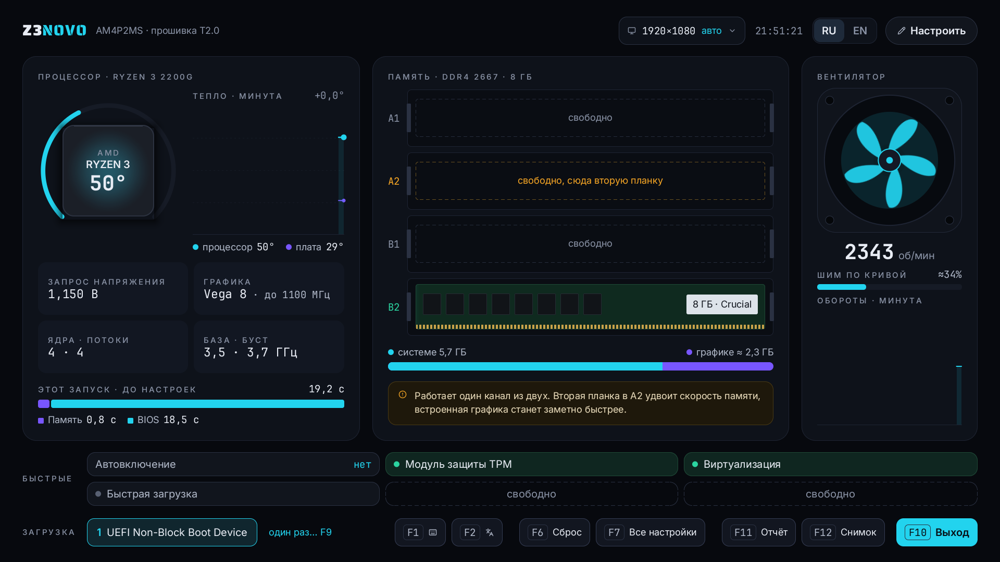

# Z3NOVO — прошивка BIOS для Lenovo ThinkCentre M715s

[Русский](#z3novo--прошивка-bios-для-lenovo-thinkcentre-m715s) · [English](#z3novo--bios-firmware-for-lenovo-thinkcentre-m715s)

> **Статус: публичный тест.** Последняя версия: [скачать](https://github.com/airtwist223/z3novo/releases/latest), [что нового](#что-нового), [полный список изменений](CHANGELOG.md), [все версии](https://github.com/airtwist223/z3novo/releases).
> Это неофициальная прошивка: не от Lenovo и не от AMD. Ставите на свой страх и риск.
> Перед установкой обязательно сохраните копию своей микросхемы BIOS (см. [docs/FLASHING.md](docs/FLASHING.md)).
> **Проверено только на плате AM4P2MS ревизии 1.1.** На других ревизиях работа не проверялась и не гарантируется.

  

Главный экран меню T2.0: процессор и его температура, память по слотам, вентилятор, быстрые настройки, внизу — строка F-клавиш.

## Отказ от ответственности

- Прошивка распространяется **«как есть», без каких-либо гарантий**. Вы устанавливаете её сами, по своему решению и на
  свой риск.
- Автор **не несёт ответственности** за любые последствия установки и использования: неработающий или повреждённый
  компьютер, вышедшие из строя детали, потерю данных, потерю гарантии, расходы на ремонт и любой другой ущерб.
- Каждая версия перед выпуском проверяется на **собственном компьютере автора** (Lenovo ThinkCentre M715s, плата AM4P2MS
  ревизии 1.1, Ryzen 3 2200G, 2 × 8 ГБ DDR4-2666). Что проверено — отмечено в таблице «Что работает, а что нет» и в [истории версий](CHANGELOG.md).
  Всё, что не отмечено как проверенное, **не проверялось** и может не работать.
- Это неофициальная прошивка. Lenovo, AMD, AMI, Biostar и Realtek к ней отношения не имеют и её не поддерживают.
  Установка неофициального BIOS может лишить вас гарантии производителя.
- Перед установкой сохраните копию своего BIOS: это единственный способ вернуть всё как было.

Устанавливая прошивку, вы соглашаетесь с этими условиями.

## Что это

Z3NOVO — прошивка для Lenovo ThinkCentre M715s (корпус SFF, плата AM4P2MS, чипсет AMD B350).
**Ревизия платы — 1.1:** только на ней прошивка проверена. Плата AM4P2MS выпускалась и в других ревизиях (например, 1.5),
и разводка у них может отличаться, поэтому на них прошивка может работать не полностью или не запуститься. Ревизия
напечатана на самой плате рядом с её названием (надпись вида «AM4P2MS Ver 1.1»); посмотрите её до установки.
Основа — AMI Aptio V с AGESA ComboAM4v2PI 1.2.0.F (от платы Biostar на том же чипсете), в которую перенесены таблицы
именно этой платы Lenovo: линии PCIe, выводы, питание, вентилятор, Super I/O. Вместо старого текстового меню —
своё графическое приложение настроек с мышью, на русском и английском.

## Что нового

T2.1 — исправления к T2.0, главное — вентиляторы ([полный список](CHANGELOG.md)):

- **После сна вентиляторы снова регулируются сами.** В T2.0 после пробуждения они оставались на средних оборотах до
  перезагрузки. В режиме «Микросхемой» прошивка теперь после сна и при включении проверяет, что микросхема опрашивает
  температуру процессора, иначе ставит полные обороты.
- **Тише в простое:** «Тихо» вентилятора процессора — штатный кулер Lenovo около 900 об/мин вместо примерно 1300;
  корпусные «Тихо» — 20 %, «Авто» — 25 % (было 30 и 35 %).
- **У каждого вентилятора свои настройки:** режим, своя кривая и «Минимум» от 0 до 100 %; защита от остановки
  вентилятора.
- **Четвёртый разъём AUX2** виден в окне «Состояние», на главном экране и в отчёте F11; он работает от одного выхода с
  AUX1 (FAN3). **Трёхпиновые вентиляторы на этой плате не регулируются ни на одном разъёме** — так устроена плата
  ([подробнее](docs/LIMITS.md#10-вентиляторы)).
- **Окно «Состояние» показывает настоящую скважность вентилятора** (раньше, например, 37,5 % показывались как «22 %»).
- **Второй курсор мыши** (стрелка родного меню BIOS поверх нашего меню) больше не появляется.
- **Устройства представляются как Lenovo** (код 17AA:36C7), а не Biostar: так их видят GPU-Z и диспетчер устройств.
- **Меню прошивки находит новый файл**, даже если на флешке скопилось много старых копий: в списке до 64 файлов, файлы
  из корня флешки — первыми, копии `Z3BACKUP` — в конце.
- **Сон на Ryzen 4000G и 5000G, исправленный в T2.0, подтвердили тестеры** с Ryzen 5 PRO 4650G и Ryzen 5 5600G.

### Как обновиться

С T2.0, T1.2 или T1.1r — прямо из меню, без программатора:

1. Если в папке `Z3NOVO` на флешке 24 и больше файлов `.BIN` (это копии `Z3BACKUP-…`, меню кладёт их туда при каждом
   обновлении), перенесите их на компьютер или возьмите флешку без них — иначе меню T2.0 и T1.x не увидит новый файл.
2. Скачайте `Z3NOVO_T2.1.bin` и его `.sha256`, положите оба на флешку FAT32 в папку `Z3NOVO`.
3. Del при включении → **Классика → Безопасность → «Прошивка BIOS» → «Обновить прошивку»** → выберите файл, включите
   сохранение копии нынешней прошивки на флешку, подтвердите и дождитесь конца записи.
4. Перезагрузите компьютер.

Настройки сохраняются. Windows при первом запуске может один раз заново найти устройства (новые коды). Подробно —
в [FLASHING.md](docs/FLASHING.md#с-t20-на-t21); с T1.2 и T1.1r — ещё и [это](docs/FLASHING.md#с-t12-или-t11r-на-t20).
Первая установка (с родного BIOS Lenovo) — только программатором.

### Что появилось в T2.0

- **Разгон процессора с защитой:** своя частота и напряжение ядер на Ryzen 2000G, 3000G и 4000G, разгон встроенной
  графики, Curve Optimizer на Ryzen 5000. Если после разгона система 3 раза подряд не загрузится, прошивка сама вернёт
  заводские значения ([пределы и оговорки](docs/LIMITS.md#6-разгон-процессора)).
- **Процессоры на 95–105 Вт по умолчанию работают в классе 65 Вт** — на это рассчитана плата. Полную мощность можно
  включить в меню на свой риск.
- **Все три вентилятора** (процессора, FAN2 и FAN3) ведёт прошивка; новое окно **«Состояние»**: температура, обороты и
  напряжения с графиками за минуту.
- **Новая заставка** с подсказками Del/F9, **строка F-клавиш** внизу меню и окно F1 «Клавиши», **F6 — сброс всех
  настроек на заводские**, **F12 — снимок экрана** на флешку.
- **Пароль BIOS, очистка TPM и ключи Secure Boot** — прямо в нашем меню.
- **Ручная частота памяти и XMP без лишней перезагрузки**; задержки памяти видны и настраиваются; «Память для графики» —
  своё число в гигабайтах.
- **DASH:** наше меню в консоли DASH; включение по сети работает и после выдёргивания шнура.
- **Компьютер называется своим именем:** Z3NOVO Labs ThinkCentre M715s Reborn.
- **Сон на Ryzen 4000G и 5000G исправлен.**

## Что умеет

- **Процессоры:** Ryzen 1000–5000 для AM4 по возможностям AGESA. На этой плате проверен только Ryzen 3 2200G.
  Процессоры без встроенной графики (например, Ryzen 7 2700, Ryzen 5 5600) работают только с видеокартой.
- **Приложение настроек (Del):** мышь и клавиатура, RU/EN, поиск по настройкам, простой режим и все настройки,
  окно «Состояние» (температура, обороты вентиляторов, напряжения), меню загрузки (F9), разрешение экрана по монитору,
  экранная клавиатура; с T2.0 — снимок экрана (F12), сброс всех настроек на заводские (F6), пароль BIOS, очистка TPM
  и ключи Secure Boot.
- **Разгон процессора** (с T2.0) — только вместе с защитой от неудачного разгона
  ([подробнее](docs/LIMITS.md#6-разгон-процессора)).
- **Вентиляторы:** плавную кривую ведёт прошивка, и после сна тоже; у каждого из трёх выходов — FAN1 (разъём CPU_FAN),
  FAN2 (SYS_FAN) и FAN3 (AUX1_FAN и AUX2_FAN вместе) — режимы «Тихо», «Авто», «Макс», своя кривая и свой «Минимум»;
  защита от остановки вентилятора (с T2.1).
- **Родная микросхема платы.** Прошивка работает с той микросхемой питания, вентиляторов и датчиков, которая стоит
  именно на M715s, — ITE IT8738. Её настройку мы взяли из родной прошивки Lenovo (те же значения, что выставляет
  BIOS Lenovo) и встроили вместо настройки чужой микросхемы платы-донора, а поверх написали свои драйверы. Поэтому
  вентилятор процессора работает на своём разъёме и регулируется самой прошивкой, а кнопка питания, включение после
  пропадания света и пробуждение работают как задумано. Прошивки, перенесённые
  с других плат, рассчитаны на другую микросхему: например, у AFOX X470D4-MA-V2 стоит IT8613, и на M715s с ней
  вентилятор процессора приходится переключать в разъём SYS_FAN, а обороты регулировать программой в Windows.
- **Стабильный старт:** исправлены зависания при включении и перезагрузке, найденные на этой плате с Ryzen 3 2200G
  (в проверке 100 перезагрузок из 100).
- **Включение после пропадания питания** (настройка «Restore on AC Power Loss»).
- **Загрузка по сети UEFI (PXE).**
- **DASH** — удалённое управление по сети через встроенную сетевую карту. По умолчанию выключено. Настройки сети
  DASH (адрес, маска, шлюз, имя) меняются прямо в приложении; с T2.0 наше меню открывается текстом и в консоли DASH.
- **Обновление прошивки с флешки** прямо из меню, без программатора ([как](docs/FLASHING.md#обновление)), и **«Отчёт для
  диагностики»** по клавише F11 — файл на флешке, который прикладывают к сообщению о проблеме ([подробнее](docs/DIAGNOSTICS.md)).

## Что мы написали сами

Z3NOVO — это не «слегка переделанный Biostar». От прошивки-донора взята только основа: код AMD и AMI, который запускает
процессор, память и чипсет. Всё, что вы видите, и всё, что делает прошивку стабильной именно на M715s, сделано заново:

- около **49 000 строк** своего кода на C в меню Z3NOVO и около **10 000 строк** в своих драйверах прошивки (C и ассемблер);
- исправлено **больше 15 модулей** Biostar, AMD, AMI и Realtek;
- около **2 500 автоматических проверок** меню в эмуляторе;
- **сотни перезагрузок** на настоящей плате, пока искали и чинили зависания.

| Что | Что делает | Что это дало |
|---|---|---|
| **Меню Z3NOVO** | графическое меню настроек внутри BIOS: мышь, RU/EN, поиск, простой режим, редактор кривой вентилятора, настройки сети DASH, отчёт F11, обновление с флешки | удобная настройка вместо старого текстового меню |
| **Z3Entry** (драйвер) | по клавишам Del и F9 открывает наше меню и наше меню загрузки | новое меню без лишних шагов |
| **Z3Chip** (драйвер) | работает с микросхемой датчиков и питания (Super I/O) с проверкой каждого обращения, выключает её собственный опрос температуры, включает компьютер после пропадания света по логике Lenovo, включает и выключает DASH | ушли зависания из-за этой микросхемы, работает автовключение |
| **Z3Fan** (драйвер) | дважды в секунду берёт температуру прямо из процессора и плавно ведёт вентиляторы (с T2.0 — все три выхода, с T2.1 — и после сна, с защитой от остановки) — и в BIOS, и в Windows, и в Linux | тихие вентиляторы без рывков |
| **Ранние исправления запуска** | ограничение времени на обмен по шине LPC, проверенная начальная настройка Super I/O, страховочный таймер на опасных участках, паузы без лишних обращений к шине | исчезли зависания при включении и перезагрузке: 100 перезагрузок из 100 |
| **Журнал запусков** | при каждом включении записывает, до какого шага дошёл запуск и почему плата перезагрузилась | по нему нашли причины зависаний; на нём держится отчёт F11 |
| **Доработанные модули AMD, Biostar и Realtek** | драйвер сетевой карты Realtek (зависал при сохранении настроек DASH), видеовыходы (DisplayPort вместо HDMI), лишние записи в микросхему Super I/O в модулях Biostar | сохраняются настройки DASH, правильно работают разъёмы DisplayPort |
| **Адаптация под плату M715s** | из родной прошивки Lenovo перенесено устройство именно этой платы: какие разъёмы и слоты куда подключены, видеовыходы, питание процессоров, настройка Super I/O | прошивка знает, как разведена M715s, а не плата-донор |
| **Инструменты вне BIOS** | скрипты отчёта для Windows и Linux, расшифровщик отчётов, [тест-флешка](https://github.com/airtwist223/z3novo/releases/tag/TestStick-1.4) | сведения о сбоях у тестеров собираются за минуту |

## Что работает, а что нет

| | ✅ Работает | ⚠️ Не проверено | ❌ Не работает |
|---|---|---|---|
| **Процессор** | Ryzen 3 2200G, Ryzen 5 2400G, Ryzen 3 3200G, Ryzen 5 3400G, Ryzen 3 4300GE, Ryzen 3 PRO 4350G, Ryzen 5 PRO 4650G, Ryzen 5 5600G; разгон ядер на 2200G; разгон графики на 2200G — работает, но возможны зависания под нагрузкой ([почему](docs/LIMITS.md#6-разгон-процессора)) | другие Ryzen 1000–5000; разгон на других процессорах; ограничение 95–105 Вт | A-серия (A6–A12) |
| **Память** | 2 и 4 планки, разгон до DDR4-3200 | XMP | напряжение выше 1,2 В |
| **Монитор** | оба DisplayPort, VGA | кабель DP→DP, второй DisplayPort в режиме HDMI | |
| **Видеокарта** | PCIe x16, Resizable BAR (Intel Arc A380), встроенная графика вместе с видеокартой | | |
| **USB** | все разъёмы | | |
| **Диски** | SATA, M.2 NVMe | | |
| **Сеть** | 1 Гбит/с, включение по сети | загрузка по сети (PXE) | |
| **DASH** | консоль, веб-страница, удалённое питание, ISO по сети, наше меню в консоли, включение после выдёргивания шнура | | |
| **Питание** | перезагрузки, сон (на Ryzen 4000G и 5000G — с T2.0), включение по таймеру и после пропадания света | | |
| **Меню BIOS** | Del, F9, F11, F6, F12, обновление с флешки и возврат на прежнюю версию, вход из Windows | пароль BIOS, Secure Boot, очистка TPM | |
| **Системы** | Windows 10, Windows 11, Linux | | |
| **Звук** | выход и микрофон | через DisplayPort | |
| **Прочее** | TPM 2.0, четырёхпиновые вентиляторы на всех четырёх разъёмах, режим и минимум у каждого вентилятора, защита от остановки вентилятора, вентиляторы после сна (проверено на 2200G, 4650G и 5600G) | COM-порт | регулировка трёхпиновых вентиляторов (так устроена плата) |

Подробности, условия проверок и отчёты тестеров — [docs/TESTED.md](docs/TESTED.md).

## Ограничения железа

Коротко: **напряжение памяти на этой плате всегда 1,2 В** — его не меняет никакая прошивка; питание процессора на плате рассчитано на
процессоры до 65 Вт (кулер и блок питания можно поставить мощнее, а схему питания на плате — только лучше охлаждать); **+12 В и +5 В
на плате не измеряются** — эти входы датчиков не подключены, поэтому программы показывают там случайные числа; **трёхпиновые вентиляторы не
регулируются** — на разъёмах вентиляторов всегда 12 В, обороты меняют только четырёхпиновые. Подробно, с последствиями для XMP, разгона,
памяти встроенной графики, DASH, Secure Boot и вентиляторов: [docs/LIMITS.md](docs/LIMITS.md).

## Документы

- [docs/FLASHING.md](docs/FLASHING.md) — установка, обновление, откат.
- [docs/LIMITS.md](docs/LIMITS.md) — что плата может и чего не может.
- [docs/DIAGNOSTICS.md](docs/DIAGNOSTICS.md) — как собрать отчёт о проблеме.
- Вопрос или отчёт о проблеме можно прислать и в Telegram-бот [@z3novo_bot](https://t.me/z3novo_bot).
- Всё работает? Расскажите через форму **«Всё работает»** в разделе Issues — так собирается список проверенных сборок.
- Есть идея, что добавить в меню или в прошивку (новый пункт, поддержка процессоров, разгон, скорость старта, PCIe…)? Форма **«Предложение»** в разделе Issues.
- Что-то неудобно или криво в меню? Форма **«Неудобство или ошибка в меню»** в разделе Issues.
- [docs/TESTED.md](docs/TESTED.md) — что проверено, на каком железе.
- [docs/KNOWN_ISSUES.md](docs/KNOWN_ISSUES.md) — известные проблемы.
- [CHANGELOG.md](CHANGELOG.md) — история версий.

## Поддержать проект

Поддержать проект можно в Telegram-боте [@z3novo_bot](https://t.me/z3novo_bot?start=donate): ссылка сразу открывает поддержку, а в самом боте это кнопка
«⭐ Поддержать проект» или команда /donate. В том же боте можно задать вопрос или отправить отчёт о проблеме.

## Лицензия

То, что написали мы (меню, драйверы, скрипты, документы), распространяется по лицензии [MIT](LICENSE): можно свободно брать,
менять и раздавать, сохранив упоминание авторов. Образ прошивки содержит также части Biostar, AMI и AMD — на них эта
лицензия не распространяется.

---

# Z3NOVO — BIOS firmware for Lenovo ThinkCentre M715s

> **Status: public test.** The latest version: [download](https://github.com/airtwist223/z3novo/releases/latest), [what is new](#what-is-new), [the full list of changes](CHANGELOG.md), [all versions](https://github.com/airtwist223/z3novo/releases).
> This is unofficial firmware, made neither by Lenovo nor by AMD. Install it at your own risk.
> Save a copy of your own BIOS chip before you install anything (see [docs/FLASHING.md](docs/FLASHING.md)).
> **Tested only on the AM4P2MS board, revision 1.1.** Other revisions have not been tested and are not guaranteed to work.

  

The T2.0 menu's home screen (shown in Russian; English is one click away): processor and its temperature, memory by slot, fan, quick settings, and the line of F keys at the bottom.

## Disclaimer

- The firmware is provided **"as is", without any warranty**. You install it yourself, by your own decision and at your
  own risk.
- The author **accepts no liability** for any consequences of installing or using it: a computer that does not work or
  is damaged, failed parts, lost data, a voided warranty, repair costs or any other damage.
- Every version is tested before release on **the author's own computer** (Lenovo ThinkCentre M715s, board AM4P2MS
  revision 1.1, Ryzen 3 2200G, 2 × 8 GB DDR4-2666). What was tested is marked in the "What works and what does not" table and in the
  [version history](CHANGELOG.md). Anything not marked as tested **has not been tested** and may not work.
- This is unofficial firmware. Lenovo, AMD, AMI, Biostar and Realtek have nothing to do with it and do not support it.
  Installing an unofficial BIOS may void the manufacturer's warranty.
- Save a copy of your BIOS before installing: it is the only way to put everything back as it was.

By installing the firmware you accept these terms.

## What it is

Z3NOVO is firmware for the Lenovo ThinkCentre M715s (SFF case, board AM4P2MS, AMD B350 chipset).
**Board revision 1.1:** the firmware has been tested only on it. The AM4P2MS was also made in other revisions (for example
1.5), and their wiring may differ, so the firmware may not fully work or may not start on them. The revision is printed on
the board next to its name (something like "AM4P2MS Ver 1.1"); check it before installing. It is AMI Aptio V with
AGESA ComboAM4v2PI 1.2.0.F (from a Biostar board with the same chipset), carrying this Lenovo board's own tables:
PCIe lanes, pins, power, fan, Super I/O. Instead of the old text menu it has its own graphical settings app with mouse
support, in Russian and English.

## What is new

T2.1 is a set of fixes to T2.0, mostly for the fans ([the full list](CHANGELOG.md)):

- **After sleep the fans are controlled again by themselves.** In T2.0, after waking up, they stayed at a medium speed
  until a restart. In "By the chip" mode the firmware now checks, after sleep and at power-on, that the chip polls the
  processor's temperature, and sets full speed otherwise.
- **Quieter at idle:** the processor fan's Quiet keeps Lenovo's stock cooler at about 900 rpm instead of about 1300; the
  case fans' Quiet is 20 % and Auto 25 % (it was 30 and 35 %).
- **Each fan has its own settings:** a mode, a custom curve and a minimum from 0 to 100 %; a guard against a stalled fan.
- **The fourth header, AUX2,** shows in the Health window, on the home screen and in the F11 report; it runs on one output
  with AUX1 (FAN3). **3-pin fans are not controlled on any header of this board**, that is how the board is built
  ([details](docs/LIMITS.md#10-fans)).
- **The Health window shows the fan's real duty** (before, a real 37.5 %, for example, showed as "22 %").
- **No more second mouse pointer** (the stock BIOS menu's arrow over our menu).
- **The devices present themselves as Lenovo's** (ID 17AA:36C7), not Biostar's: that is how GPU-Z and Device Manager see
  them.
- **The firmware menu finds a new file** even when many old copies have piled up on the stick: up to 64 files in the
  list, the files in the stick's root first, the `Z3BACKUP` copies last.
- **Sleep on the Ryzen 4000G and 5000G, fixed in T2.0, has been confirmed by testers** with a Ryzen 5 PRO 4650G and a
  Ryzen 5 5600G.

### How to update

From T2.0, T1.2 or T1.1r, right from the menu, with no programmer:

1. If the stick's `Z3NOVO` folder holds 24 or more `.BIN` files (the `Z3BACKUP-…` copies the menu puts there at every
   update), move them to a computer or use a stick without them; otherwise the T2.0 and T1.x menu does not see the new
   file.
2. Download `Z3NOVO_T2.1.bin` and its `.sha256`, and put both on a FAT32 USB stick in a `Z3NOVO` folder.
3. Del at power-on → **Classic → Security → BIOS firmware → Update firmware** → pick the file, turn on saving a copy of
   the current firmware to the stick, confirm and wait for the write to finish.
4. Restart.

Settings are kept. At the first start Windows may find some devices anew, once (the new IDs). Details:
[FLASHING.md](docs/FLASHING.md#from-t20-to-t21); from T1.2 and T1.1r, also [this](docs/FLASHING.md#from-t12-or-t11r-to-t20).
The first install (from Lenovo's BIOS) needs a programmer.

### What came in T2.0

- **Processor overclocking with protection:** your own core clock and voltage on the Ryzen 2000G, 3000G and 4000G,
  built-in graphics overclocking, Curve Optimizer on the Ryzen 5000. If after an overclock the system fails to start 3
  times in a row, the firmware puts the factory values back by itself
  ([limits and caveats](docs/LIMITS.md#6-processor-overclocking)).
- **95–105 W processors run in the 65 W class by default**, which is what the board is built for. Full power can be
  turned on in the menu at your own risk.
- **All three fans** (the processor's, FAN2 and FAN3) are driven by the firmware; a new **Health** window: temperature,
  fan speeds and voltages with one-minute graphs.
- **A new boot screen** with Del/F9 hints, **a line of F keys** at the bottom of the menu and the F1 Keys window, **F6 to
  reset every setting to factory**, **F12 to save a screenshot** to a USB stick.
- **The BIOS password, clearing the TPM and the Secure Boot keys** right in our menu.
- **Manual memory speed and XMP without the extra restart**; the memory delays are shown and can be set; "Memory for
  graphics" is a number of your own, in gigabytes.
- **DASH:** our menu in the DASH console; power-on over the network works after the power cord was out, too.
- **The computer goes by its own name:** Z3NOVO Labs ThinkCentre M715s Reborn.
- **Sleep on the Ryzen 4000G and 5000G is fixed.**

## What it does

- **Processors:** AM4 Ryzen 1000–5000 as far as AGESA supports them. Only the Ryzen 3 2200G has been tested on this board.
  Processors without integrated graphics (for example the Ryzen 7 2700 or Ryzen 5 5600) need a graphics card.
- **Settings app (Del):** mouse and keyboard, RU/EN, settings search, a simple view and all settings, a Health window
  (temperature, fan speeds, voltages), a boot menu (F9), screen resolution from the monitor, an on-screen keyboard; from
  T2.0 also screenshots (F12), resetting every setting to factory (F6), the BIOS password, clearing the TPM and the
  Secure Boot keys.
- **Processor overclocking** (from T2.0), only together with the protection against a failed overclock
  ([details](docs/LIMITS.md#6-processor-overclocking)).
- **Fans:** the firmware drives a smooth curve, after sleep too; each of the three outputs — FAN1 (the CPU_FAN header),
  FAN2 (SYS_FAN) and FAN3 (AUX1_FAN and AUX2_FAN together) — has the Quiet, Auto and Max presets, a custom curve and a
  minimum of its own; a guard against a stalled fan (from T2.1).
- **The board's own chip.** The firmware works with the power, fan and sensor chip that the M715s actually has, the
  ITE IT8738. We took its setup from Lenovo's own firmware (the same values Lenovo's BIOS sets), put it in place of
  the donor board's setup for a different chip, and wrote our own drivers on top. So the processor fan runs on its own
  header and is controlled by the firmware itself, and the power button, power-on after a power cut and wake-up work
  as intended. Firmware carried over from other boards expects a
  different chip: the AFOX X470D4-MA-V2, for example, has an IT8613, and on an M715s with it the processor fan has to
  be moved to the SYS_FAN header and its speed set by a program in Windows.
- **Reliable start:** fixes for hangs at power-on and reboot found on this board with the Ryzen 3 2200G (100 out of 100
  reboots in testing).
- **Power on after a power loss** (the "Restore on AC Power Loss" setting).
- **UEFI network boot (PXE).**
- **DASH** remote management over the onboard network card. Off by default. Its network settings (address, mask,
  gateway, name) are edited right in the app; from T2.0 our menu opens as text in the DASH console too.
- **Firmware updates from a USB stick** right from the menu, without a programmer ([how](docs/FLASHING.md#updating)), and a
  **"Diagnostics report"** on the F11 key — a file on a USB stick to attach to a problem report ([details](docs/DIAGNOSTICS.md)).

## What we wrote ourselves

Z3NOVO is not "a lightly modified Biostar". Only the base comes from the donor firmware: the AMD and AMI code that starts
the processor, memory and chipset. Everything you see, and everything that makes the firmware stable on the M715s itself,
was made from scratch:

- about **49,000 lines** of our own C code in the Z3NOVO menu and about **10,000 lines** in our own firmware drivers (C and
  assembly);
- **more than 15 modules** from Biostar, AMD, AMI and Realtek fixed;
- about **2,500 automatic checks** of the menu in an emulator;
- **hundreds of restarts** on a real board while the hangs were found and fixed.

| What | What it does | What it gave |
|---|---|---|
| **Z3NOVO menu** | a graphical settings menu inside the BIOS: mouse, RU/EN, search, a simple view, a fan curve editor, DASH network settings, the F11 report, updates from a USB stick | easy setup instead of the old text menu |
| **Z3Entry** (driver) | opens our menu and our boot menu on the Del and F9 keys | the new menu with no extra steps |
| **Z3Chip** (driver) | talks to the board's sensor and power chip (Super I/O), checking every access; turns off the chip's own temperature polling; powers the computer on after a power cut the way Lenovo does; turns DASH on and off | the hangs caused by this chip are gone, power-on after a power cut works |
| **Z3Fan** (driver) | twice a second reads the temperature straight from the processor and drives the fans smoothly (from T2.0 all three outputs, from T2.1 after sleep too, with a stall guard) — in the BIOS, in Windows and in Linux | quiet fans without jumps |
| **Early start fixes** | a time limit on the LPC bus, a checked Super I/O setup, a safety timer over risky steps, pauses that do not hammer the bus | the hangs at power-on and restart are gone: 100 restarts out of 100 |
| **Boot log** | on every power-on, records how far the start got and why the board restarted | it found the causes of the hangs; the F11 report is built on it |
| **Reworked AMD, Biostar and Realtek modules** | the Realtek network card driver (hung when saving DASH settings), the video outputs (DisplayPort instead of HDMI), stray writes to the Super I/O chip in Biostar's modules | DASH settings save, the DisplayPort sockets work as they should |
| **Fitted to the M715s board** | the layout of this very board taken over from Lenovo's own firmware: which sockets and slots go where, the video outputs, processor power, the Super I/O setup | the firmware knows how the M715s is wired, not the donor board |
| **Tools outside the BIOS** | report scripts for Windows and Linux, a report decoder, a [test stick](https://github.com/airtwist223/z3novo/releases/tag/TestStick-1.4) | testers collect failure details in a minute |

## What works and what does not

| | ✅ Works | ⚠️ Not tested | ❌ Does not work |
|---|---|---|---|
| **Processor** | Ryzen 3 2200G, Ryzen 5 2400G, Ryzen 3 3200G, Ryzen 5 3400G, Ryzen 3 4300GE, Ryzen 3 PRO 4350G, Ryzen 5 PRO 4650G, Ryzen 5 5600G; core overclocking on the 2200G; graphics overclocking on the 2200G works, but it may freeze under load ([why](docs/LIMITS.md#6-processor-overclocking)) | other Ryzen 1000–5000; overclocking on other processors; the 95–105 W limit | A-series (A6–A12) |
| **Memory** | 2 and 4 sticks, overclocking up to DDR4-3200 | XMP | voltage above 1.2 V |
| **Monitor** | both DisplayPort sockets, VGA | DP→DP cable, the second DisplayPort socket in HDMI mode | |
| **Graphics card** | PCIe x16, Resizable BAR (Intel Arc A380), built-in graphics together with a card | | |
| **USB** | every socket | | |
| **Drives** | SATA, M.2 NVMe | | |
| **Network** | 1 Gbit/s, power-on over the network | network boot (PXE) | |
| **DASH** | console, web page, remote power, ISO over the network, our menu in the console, power-on after the cord was out | | |
| **Power** | restarts, sleep (on the Ryzen 4000G and 5000G from T2.0), power-on by timer and after a power cut | | |
| **BIOS menu** | Del, F9, F11, F6, F12, update from a USB stick and going back to an earlier version, opening from Windows | BIOS password, Secure Boot, clearing the TPM | |
| **Systems** | Windows 10, Windows 11, Linux | | |
| **Sound** | output and microphone | over DisplayPort | |
| **Other** | TPM 2.0, 4-pin fans on all four headers, a mode and a minimum for each fan, the stall guard, fans after sleep (tested on the 2200G, 4650G and 5600G) | COM port | controlling 3-pin fans (the board is built that way) |

Details, test conditions and testers' reports: [docs/TESTED.md](docs/TESTED.md).

## Hardware limits

In short: **the memory voltage on this board is always 1.2 V**, no firmware can change it, and the board's processor power circuit is built
for processors up to 65 W (the cooler and the power supply can be upgraded; the board's power circuit can only be cooled better); **+12 V and
+5 V are not measured on this board**: those sensor inputs are not connected, so programs show random numbers there; **3-pin fans are not
controlled**: the fan headers always carry 12 V, and only 4-pin fans change speed. Details, including what this means for XMP, overclocking,
integrated graphics memory, DASH, Secure Boot and fans: [docs/LIMITS.md](docs/LIMITS.md).

## Documents

- [docs/FLASHING.md](docs/FLASHING.md) — installing, updating, going back.
- [docs/LIMITS.md](docs/LIMITS.md) — what the board can and cannot do.
- [docs/DIAGNOSTICS.md](docs/DIAGNOSTICS.md) — how to collect a problem report.
- Questions and problem reports can also go to the Telegram bot [@z3novo_bot](https://t.me/z3novo_bot).
- Everything works? Tell us with the **"Works for me"** form under Issues — it builds the list of tested setups.
- An idea for the menu or the firmware (a new item, processor support, overclocking, start-up speed, PCIe…)? The **"Suggestion"** form under Issues.
- Something awkward or off in the menu? The **"Menu annoyance or glitch"** form under Issues.
- [docs/TESTED.md](docs/TESTED.md) — what has been tested, on which hardware.
- [docs/KNOWN_ISSUES.md](docs/KNOWN_ISSUES.md) — known problems.
- [CHANGELOG.md](CHANGELOG.md) — version history.

## Support the project

You can support the project in the Telegram bot [@z3novo_bot](https://t.me/z3novo_bot?start=donate): the link opens the support menu straight away; in the
bot itself it is the «⭐ Поддержать проект» ("Support the project") button or the /donate command. The same bot takes questions and problem reports.

## License

What we wrote ourselves (the menu, drivers, scripts and documents) is under the [MIT](LICENSE) licence: you may freely take,
change and share it as long as the authors are credited. The firmware image also contains parts by Biostar, AMI and AMD;
this licence does not cover them.
